# 基于Java的免税商品优选购物商城设计与实现代码

> 🎓 **计算机毕业设计 · 基于Java的免税商品优选购物商城设计与实现代码**
>
> 本仓库只放**项目介绍 + 运行截图**（截图是站点带水印的原图，存在仓库 `images/` 里）。
>
> 👉 **完整可运行源码 / 数据库脚本 / 部署文档：[点我获取](https://geekcode.top/archives/%E5%9F%BA%E4%BA%8EJava%E7%9A%84%E5%85%8D%E7%A8%8E%E5%95%86%E5%93%81%E4%BC%98%E9%80%89%E8%B4%AD%E7%89%A9%E5%95%86%E5%9F%8E%E8%AE%BE%E8%AE%A1%E4%B8%8E%E5%AE%9E%E7%8E%B0%E4%BB%A3%E7%A0%81?utm_source=github)**
>
> 💬 咨询微信：**ir9372**　|　🌐 更多项目：[极客代码 geekcode.top](https://geekcode.top/?utm_source=github)
>
> 📌 项目详情页：<https://geekcode.top/archives/%E5%9F%BA%E4%BA%8EJava%E7%9A%84%E5%85%8D%E7%A8%8E%E5%95%86%E5%93%81%E4%BC%98%E9%80%89%E8%B4%AD%E7%89%A9%E5%95%86%E5%9F%8E%E8%AE%BE%E8%AE%A1%E4%B8%8E%E5%AE%9E%E7%8E%B0%E4%BB%A3%E7%A0%81?utm_source=github>

<table><td width="230" align="center"> <b>扫码加微信 ir9372</b></td><td valign="middle">📦 源码 = 项目介绍 + 全部运行截图 + 数据库 + 部署文档 👉 点上方任意截图，直接跳到 <b>极客代码 geekcode.top</b> 详情页</td></table>

---

<h1>基于Java的免税商品优选购物商城设计与实现代码</h1>
<h2>项目概述</h2>

本项目为“基于Java的免税商品优选购物商城设计与实现代码”，面向免税商品展示、用户浏览购物与后台运营管理等场景。系统采用 Vue 与 Spring Boot 集成架构，后端使用 MyBatis-Plus、Shiro 和 MySQL，实现商品信息、商品分类、商城快讯、商家信息、在线客服信息、评论、购物车、订单、地址、收藏及个人中心等前台功能，并提供后台统一管理入口。项目核心目标是为用户提供浏览、收藏、下单和互动入口，为管理员提供用户、商品、订单、评论和配置等管理能力，适用于毕业设计中的电商类管理系统实践。

<h2>技术架构</h2>
<h3>总体架构设计</h3>

本项目整体采用前后端集成式架构。前端通过 Vue 页面实现前台用户端与后台管理端界面，后端基于 Spring Boot 提供 Web 接口、业务处理和页面集成能力。系统运行过程中，前端页面发起请求，后端 Controller 接收并处理请求，通过 Service 层完成业务逻辑，通过 MyBatis-Plus 操作 MySQL 数据库，最终返回数据或页面响应。

系统包含前台用户端和后台管理端两部分：

<ul>
<li>前台用户端主要面向普通购物用户，提供首页、登录注册、商品信息、商城快讯、商品分类、商家信息、在线客服信息、评论浏览、购物车、个人中心、订单、地址和收藏等功能入口。</li>
<li>后台管理端主要面向管理员，提供用户、商家、商品、商品分类、商城快讯、在线客服、评论、订单、收藏、轮播图与系统配置等管理功能。</li>
</ul>
<h3>后端分层结构</h3>

后端采用典型的 Web 应用分层结构，主要包括 Controller 层、业务处理层、数据访问层和数据库层。

根据项目源码上下文，Controller 层包含以下接口控制器：

<ul>
<li><code>AddressController</code>：负责用户地址相关接口。</li>
<li><code>CartController</code>：负责购物车相关接口。</li>
<li><code>CommonController</code>：负责通用接口或公共业务处理。</li>
<li><code>ConfigController</code>：负责系统配置相关接口，与轮播图管理、前台展示配置等能力相关。</li>
<li><code>DiscussshangpinxinxiController</code>：负责商品信息评论相关接口。</li>
<li><code>DiscusszaixiankefuController</code>：负责在线客服评论相关接口。</li>
<li><code>FileController</code>：负责文件上传相关接口。</li>
<li><code>NewsController</code>：负责商城快讯相关接口。</li>
<li><code>OrdersController</code>：负责订单相关接口。</li>
<li><code>ShangjiaController</code>：负责商家信息相关接口。</li>
<li><code>ShangpinfenleiController</code>：负责商品分类相关接口。</li>
<li><code>ShangpinxinxiController</code>：负责商品信息管理相关接口。</li>
</ul>

这些控制器共同支撑前台浏览、个人中心、购物车、订单、收藏、评论以及后台管理等功能模块。

<h3>数据访问与持久化</h3>

数据访问层采用 MyBatis-Plus 与 MyBatis 相关依赖，结合 <code>spring-boot-starter-jdbc</code> 和 <code>mysql-connector-java</code> 完成数据库连接、SQL 执行和对象关系映射。

MyBatis-Plus 在项目中主要用于简化常规数据访问操作，降低单表 CRUD 的重复代码量。系统围绕商品、订单、用户、评论、收藏、地址、快讯、商家、在线客服、配置等业务对象进行数据持久化管理。

<h3>数据库设计要点</h3>

根据后台路由、前台功能截图和控制器接口，数据库设计主要围绕以下业务对象展开：

<ul>
<li>用户信息：用于前台登录、注册及个人中心。</li>
<li>商品信息：用于商品列表、商品详情和后台商品管理。</li>
<li>商品分类信息：用于前台商品分类浏览和后台分类管理。</li>
<li>商城快讯信息：用于前台快讯列表、详情展示和后台快讯管理。</li>
<li>商家信息：用于前台商家列表、商家详情和后台商家管理。</li>
<li>在线客服信息：用于前台在线客服列表、详情展示和后台客服信息管理。</li>
<li>商品信息评论：用于商品评论列表、评论详情和后台评论管理。</li>
<li>在线客服评论：用于在线客服评论列表、评论详情和后台评论管理。</li>
<li>购物车信息：用于前台购物车列表展示。</li>
<li>订单信息：用于前台我的订单和后台订单管理。</li>
<li>地址信息：用于前台我的地址管理。</li>
<li>收藏信息：用于前台我的收藏和后台收藏管理。</li>
<li>配置信息：用于轮播图管理、系统展示配置等。</li>
</ul>

数据库设计以电商业务主链路为核心，覆盖用户浏览、商品展示、购物车、订单、收藏、地址、评论和后台管理的数据关系。

<h3>核心技术选型理由</h3>
<ul>
<li><strong>Spring Boot</strong>：用于快速搭建 Java Web 后端应用，提供依赖管理、自动配置、内置 Web 容器和接口服务能力，适合毕业设计项目快速开发与部署。</li>
<li><strong>MyBatis-Plus</strong>：在 MyBatis 基础上增强数据访问能力，简化常规 CRUD 操作，适合商品、订单、评论、收藏等频繁增删改查的业务场景。</li>
<li><strong>Shiro</strong>：用于系统登录认证和访问控制，为前台用户登录、注册以及后台管理端权限访问提供安全支撑。</li>
<li><strong>MySQL</strong>：作为关系型数据库，用于存储用户、商品、订单、评论、地址、收藏、快讯、商家、客服和配置等业务数据。</li>
<li><strong>Vue 集成架构</strong>：项目类型为 <code>vue-integrated</code>，前端页面与后端工程集成，便于形成完整的前台展示页面和后台管理页面。</li>
<li><strong>validation-api</strong>：用于请求参数校验，提高接口输入数据的规范性。</li>
<li><strong>commons-lang3</strong>：提供通用工具类支持，增强后端业务处理中的基础能力。</li>
</ul>
<h2>功能模块</h2>
<h3>前台用户端功能模块</h3>

前台用户端主要面向普通用户，提供商品浏览、资讯查看、个人中心、购物车、订单、地址、收藏和评论查看等功能。

<table>
<thead>
<tr>
<th>功能模块</th>
<th>功能说明</th>
</tr>
</thead>
<tbody><tr>
<td>前台首页</td>
<td>展示商城入口信息，是用户进入系统后的主要浏览页面。</td>
</tr>
<tr>
<td>前台登录页</td>
<td>提供普通用户登录入口，登录后可进入个人中心及相关业务页面。</td>
</tr>
<tr>
<td>前台注册页</td>
<td>提供用户注册入口，用于创建前台用户账号。</td>
</tr>
<tr>
<td>商品信息列表</td>
<td>展示商品列表，用户可浏览免税商品优选商城中的商品信息。</td>
</tr>
<tr>
<td>商品信息详情</td>
<td>展示单个商品的详细信息，便于用户查看商品内容。</td>
</tr>
<tr>
<td>商品分类列表</td>
<td>展示商品分类信息，支持按分类查看商品相关内容。</td>
</tr>
<tr>
<td>商城快讯列表</td>
<td>展示商城快讯信息列表。</td>
</tr>
<tr>
<td>商城快讯详情</td>
<td>展示单条商城快讯的详细内容。</td>
</tr>
<tr>
<td>商家列表</td>
<td>展示商家信息列表。</td>
</tr>
<tr>
<td>商家详情</td>
<td>展示单个商家的详细信息。</td>
</tr>
<tr>
<td>在线客服列表</td>
<td>展示在线客服相关信息列表，用于查看客服信息内容。</td>
</tr>
<tr>
<td>在线客服详情</td>
<td>展示单个在线客服信息的详细内容。</td>
</tr>
<tr>
<td>商品信息评论列表</td>
<td>展示商品相关评论列表。</td>
</tr>
<tr>
<td>商品信息评论详情</td>
<td>展示单条商品信息评论的详细内容。</td>
</tr>
<tr>
<td>在线客服评论列表</td>
<td>展示在线客服相关评论列表。</td>
</tr>
<tr>
<td>在线客服评论详情</td>
<td>展示单条在线客服评论的详细内容。</td>
</tr>
<tr>
<td>购物车列表</td>
<td>展示用户购物车中的商品列表信息。</td>
</tr>
<tr>
<td>个人中心</td>
<td>展示用户个人信息及个人中心入口。</td>
</tr>
<tr>
<td>我的订单</td>
<td>展示用户相关订单列表。</td>
</tr>
<tr>
<td>我的地址</td>
<td>展示用户地址列表，支持地址信息查看与管理。</td>
</tr>
<tr>
<td>我的收藏</td>
<td>展示用户收藏的商品或内容信息。</td>
</tr>
</tbody></table>
<h3>后台管理端功能模块</h3>

后台管理端主要面向管理员，用于维护商城基础数据、用户数据、商品数据、订单数据、评论数据和系统配置数据。

<table>
<thead>
<tr>
<th>功能模块</th>
<th>功能说明</th>
</tr>
</thead>
<tbody><tr>
<td>后台登录页</td>
<td>提供管理员进入后台管理系统的登录入口。</td>
</tr>
<tr>
<td>后台首页</td>
<td>作为后台管理端的主入口页面，用于进入各管理模块。</td>
</tr>
<tr>
<td>用户管理</td>
<td>对应后台路由 <code>/yonghu</code>，用于管理前台用户信息。</td>
</tr>
<tr>
<td>商家管理</td>
<td>对应后台路由 <code>/shangjia</code>，用于管理商家信息。</td>
</tr>
<tr>
<td>商品分类管理</td>
<td>对应后台路由 <code>/shangpinfenlei</code>，用于管理商品分类信息。</td>
</tr>
<tr>
<td>商品信息管理</td>
<td>对应后台路由 <code>/shangpinxinxi</code>，用于管理商品基础信息。</td>
</tr>
<tr>
<td>商城快讯管理</td>
<td>对应后台路由 <code>/news</code>，用于管理前台展示的商城快讯内容。</td>
</tr>
<tr>
<td>在线客服管理</td>
<td>对应后台路由 <code>/zaixiankefu</code>，用于管理在线客服信息。</td>
</tr>
<tr>
<td>在线客服评论管理</td>
<td>对应后台路由 <code>/discusszaixiankefu</code>，用于管理在线客服相关评论。</td>
</tr>
<tr>
<td>商品信息评论管理</td>
<td>对应后台路由 <code>/discussshangpinxinxi</code>，用于管理商品信息相关评论。</td>
</tr>
<tr>
<td>订单管理</td>
<td>对应后台路由 <code>/orders/:status</code>，用于按状态查看和管理订单信息。</td>
</tr>
<tr>
<td>我的收藏管理</td>
<td>对应后台路由 <code>/storeup</code>，用于管理用户收藏信息。</td>
</tr>
<tr>
<td>轮播图管理</td>
<td>用于管理系统轮播图或首页展示图片配置，与后台配置管理能力相关。</td>
</tr>
<tr>
<td>文件上传支持</td>
<td>通过 <code>FileController</code> 提供文件上传相关接口，可用于图片或其他资源上传场景。</td>
</tr>
</tbody></table>
<h2>用户角色与权限</h2>

根据项目前台页面、后台路由和截图功能，系统主要涉及两类使用角色：前台普通用户和后台管理员。

<table>
<thead>
<tr>
<th>角色</th>
<th>使用入口</th>
<th>主要权限与功能范围</th>
</tr>
</thead>
<tbody><tr>
<td>前台普通用户</td>
<td>前台首页、登录页、注册页、个人中心</td>
<td>可浏览商品信息、商品分类、商城快讯、商家信息、在线客服信息、商品评论和在线客服评论；可使用购物车列表；可查看或管理个人中心、我的订单、我的地址、我的收藏。</td>
</tr>
<tr>
<td>后台管理员</td>
<td>后台登录页、后台首页、后台各管理路由</td>
<td>可进入后台管理系统，对用户、商家、商品分类、商品信息、商城快讯、在线客服、在线客服评论、商品信息评论、订单、收藏、轮播图或系统配置进行管理。</td>
</tr>
</tbody></table>
<h3>权限边界说明</h3>
<ul>
<li>前台普通用户主要使用浏览、查询、收藏、购物车、订单、地址和个人中心相关功能。</li>
<li>后台管理员主要使用数据管理和系统维护功能。</li>
<li>后台管理路由如 <code>/news</code>、<code>/yonghu</code>、<code>/shangpinfenlei</code>、<code>/shangpinxinxi</code>、<code>/orders/:status</code>、<code>/storeup</code>、<code>/config</code> 等属于后台管理入口，不面向普通前台用户开放。</li>
<li>在线客服模块在项目中表现为信息展示、详情查看和评论管理能力，不扩展为实时聊天会话系统。</li>
<li>订单模块支持按状态进行路由访问，具体订单状态处理流程以系统实际配置为准。</li>
</ul>
<h2>项目特色与创新点</h2>
<h3>面向免税商品优选购物场景</h3>

项目围绕免税商品优选购物商城场景设计，提供商品信息展示、商品分类浏览、商城快讯发布、商家信息展示和在线客服信息展示等能力，形成较完整的电商展示与管理原型。

<h3>前台购物与后台管理一体化</h3>

系统同时包含前台用户端和后台管理端。前台端满足用户浏览商品、查看快讯、使用购物车、查看订单、管理地址和收藏等需求；后台端满足管理员维护商品、订单、用户、评论、分类、快讯、商家、客服和配置等需求，形成前后端一体化商城管理系统。

<h3>覆盖电商基础业务链路</h3>

项目包含商品信息、商品分类、购物车、订单、地址、收藏、评论等常见电商基础模块，能够体现购物类系统从商品浏览到用户个人数据管理的基本流程。

<h3>支持评论与客服信息互动展示</h3>

系统包含商品信息评论和在线客服评论两类评论模块，并分别提供前台列表、详情展示以及后台管理入口，便于对商品反馈和客服反馈信息进行统一查看与管理。

<h3>后台管理能力较为集中</h3>

后台管理端覆盖用户、商家、商品、分类、快讯、在线客服、评论、订单、收藏和轮播图配置等模块，管理员可通过统一后台入口完成商城基础数据维护。

<h3>技术选型适合毕业设计实践</h3>

项目采用 Spring Boot、MyBatis-Plus、Shiro、MySQL 和 Vue 集成方案，技术组合成熟，能够体现 Java Web 项目、数据库设计、权限控制、前后端页面开发和业务模块管理等毕业设计核心能力。

<h2>部署环境</h2>
<table>
<thead>
<tr>
<th>环境项</th>
<th>说明</th>
</tr>
</thead>
<tbody><tr>
<td>JDK</td>
<td>需要安装与项目 Spring Boot 及后端依赖兼容的 JDK 运行环境。项目上下文未指定具体版本，部署时应以项目实际配置和依赖版本为准。</td>
</tr>
<tr>
<td>MySQL</td>
<td>用于存储用户、商品、分类、快讯、商家、在线客服、评论、订单、地址、购物车、收藏和配置等业务数据。</td>
</tr>
<tr>
<td>Maven</td>
<td>用于 Java 后端依赖管理与项目构建。根据项目依赖列表，可推断后端采用 Maven 相关依赖管理方式。</td>
</tr>
<tr>
<td>Node.js / npm</td>
<td>项目类型为 Vue 集成型，前端资源构建或依赖管理可能需要 Node.js 环境。</td>
</tr>
<tr>
<td>Web 容器</td>
<td>Spring Boot 项目通常使用内置 Tomcat 运行，部署时无需单独配置外部 Tomcat，具体以项目打包方式为准。</td>
</tr>
<tr>
<td>浏览器</td>
<td>前台和后台页面建议使用 Chrome、Edge 等现代浏览器访问。</td>
</tr>
<tr>
<td>数据库连接配置</td>
<td>部署时需要配置 MySQL 数据库地址、端口、用户名、密码及数据库名称。</td>
</tr>
<tr>
<td>文件存储配置</td>
<td>项目包含 <code>FileController</code>，涉及文件上传能力，部署时需要保证上传目录或存储路径可访问、可写入。</td>
</tr>
<tr>
<td>Shiro 安全配置</td>
<td>系统使用 Shiro 进行认证与访问控制，部署时应确认后台管理路由、登录状态和权限拦截配置正常。</td>
</tr>
</tbody></table>
<h2>五、技术特性</h2>
<ul>
<li>前后端集成部署，前端资源打包至后端 static 目录</li>
<li>使用 MyBatis-Plus 简化数据访问层开发</li>
<li>集成 Shiro 权限框架实现角色权限控制</li>
</ul>
<h2>六、功能模块截图</h2>
<h3>前台用户端</h3>
<h4>前台首页</h4>

<h4>前台登录页</h4>

<h4>前台注册页</h4>

<h4>前台-商城快讯列表</h4>

<h4>前台-商品信息列表</h4>

<h4>前台-商品信息评论列表</h4>

<h4>前台-在线客服评论列表</h4>

<h4>前台-商家列表</h4>

<h4>前台-在线客服列表</h4>

<h4>前台个人中心</h4>

<a href="https://geekcode.top/archives/%E5%9F%BA%E4%BA%8EJava%E7%9A%84%E5%85%8D%E7%A8%8E%E5%95%86%E5%93%81%E4%BC%98%E9%80%89%E8%B4%AD%E7%89%A9%E5%95%86%E5%9F%8E%E8%AE%BE%E8%AE%A1%E4%B8%8E%E5%AE%9E%E7%8E%B0%E4%BB%A3%E7%A0%81?utm_source=github" title="查看完整源码">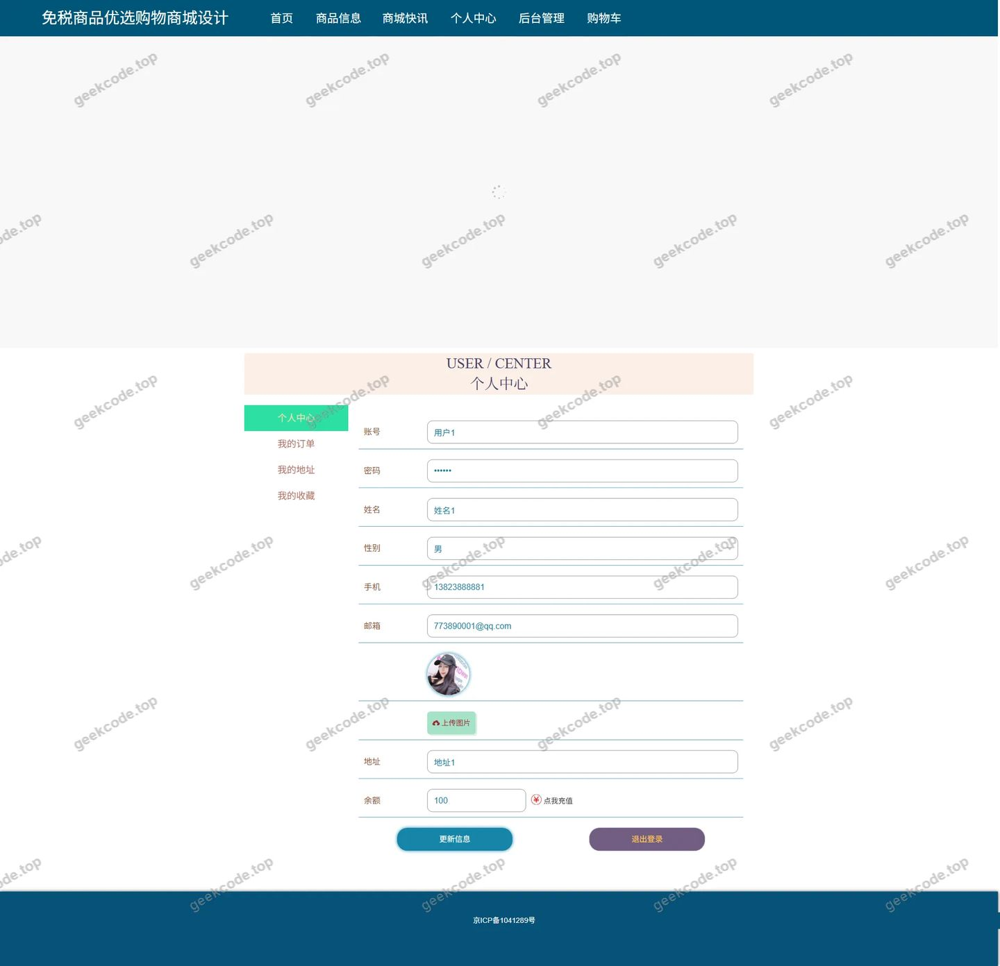</a>

<h4>前台-我的地址列表</h4>

<h4>前台-我的订单列表</h4>

<a href="https://geekcode.top/archives/%E5%9F%BA%E4%BA%8EJava%E7%9A%84%E5%85%8D%E7%A8%8E%E5%95%86%E5%93%81%E4%BC%98%E9%80%89%E8%B4%AD%E7%89%A9%E5%95%86%E5%9F%8E%E8%AE%BE%E8%AE%A1%E4%B8%8E%E5%AE%9E%E7%8E%B0%E4%BB%A3%E7%A0%81?utm_source=github" title="查看完整源码">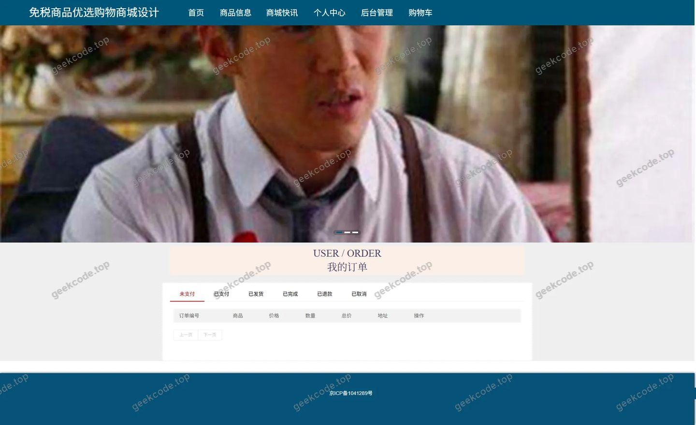</a>

<h4>前台-我的收藏列表</h4>

<h4>前台-商城快讯-详情</h4>

<h4>前台-商品信息-详情</h4>

<a href="https://geekcode.top/archives/%E5%9F%BA%E4%BA%8EJava%E7%9A%84%E5%85%8D%E7%A8%8E%E5%95%86%E5%93%81%E4%BC%98%E9%80%89%E8%B4%AD%E7%89%A9%E5%95%86%E5%9F%8E%E8%AE%BE%E8%AE%A1%E4%B8%8E%E5%AE%9E%E7%8E%B0%E4%BB%A3%E7%A0%81?utm_source=github" title="查看完整源码">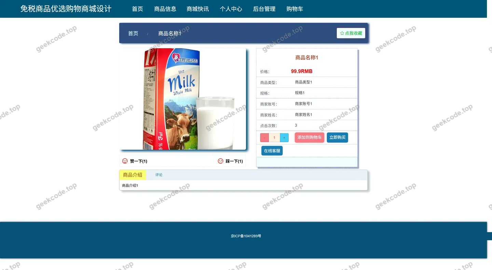</a>

<h4>前台-商品分类列表</h4>

<h4>前台-购物车列表</h4>

<h4>前台-商品信息评论-详情</h4>

<a href="https://geekcode.top/archives/%E5%9F%BA%E4%BA%8EJava%E7%9A%84%E5%85%8D%E7%A8%8E%E5%95%86%E5%93%81%E4%BC%98%E9%80%89%E8%B4%AD%E7%89%A9%E5%95%86%E5%9F%8E%E8%AE%BE%E8%AE%A1%E4%B8%8E%E5%AE%9E%E7%8E%B0%E4%BB%A3%E7%A0%81?utm_source=github" title="查看完整源码">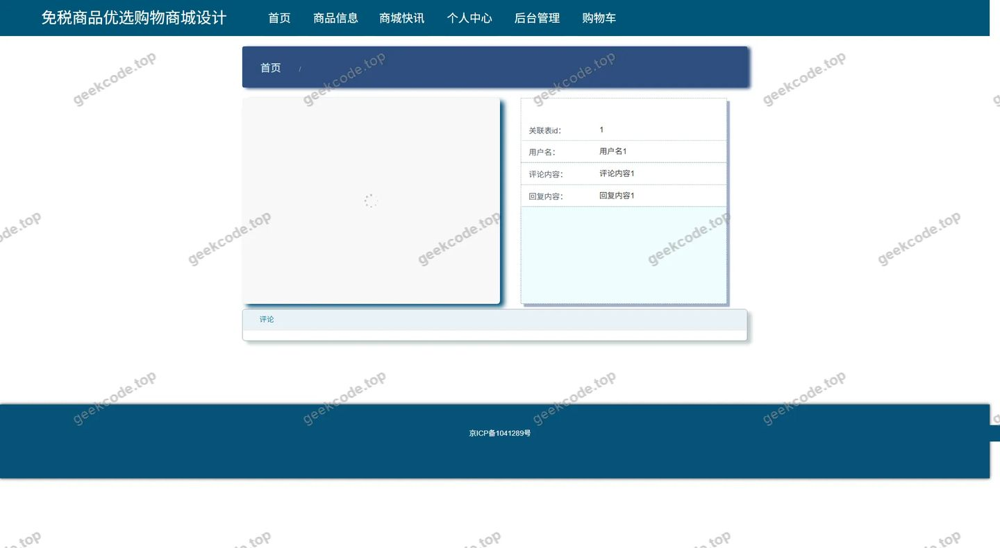</a>

<h4>前台-在线客服评论-详情</h4>

<h4>前台-商家-详情</h4>

<h4>前台-在线客服-详情</h4>

<a href="https://geekcode.top/archives/%E5%9F%BA%E4%BA%8EJava%E7%9A%84%E5%85%8D%E7%A8%8E%E5%95%86%E5%93%81%E4%BC%98%E9%80%89%E8%B4%AD%E7%89%A9%E5%95%86%E5%9F%8E%E8%AE%BE%E8%AE%A1%E4%B8%8E%E5%AE%9E%E7%8E%B0%E4%BB%A3%E7%A0%81?utm_source=github" title="查看完整源码">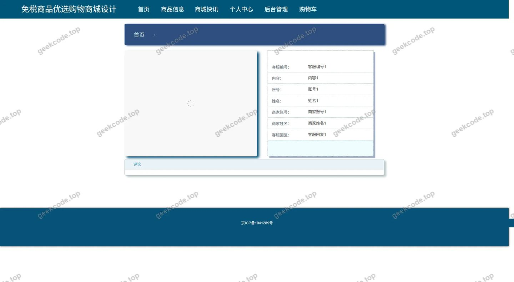</a>

<h3>后台管理端</h3>
<h4>后台-系统配置</h4>

<a href="https://geekcode.top/archives/%E5%9F%BA%E4%BA%8EJava%E7%9A%84%E5%85%8D%E7%A8%8E%E5%95%86%E5%93%81%E4%BC%98%E9%80%89%E8%B4%AD%E7%89%A9%E5%95%86%E5%9F%8E%E8%AE%BE%E8%AE%A1%E4%B8%8E%E5%AE%9E%E7%8E%B0%E4%BB%A3%E7%A0%81?utm_source=github" title="查看完整源码">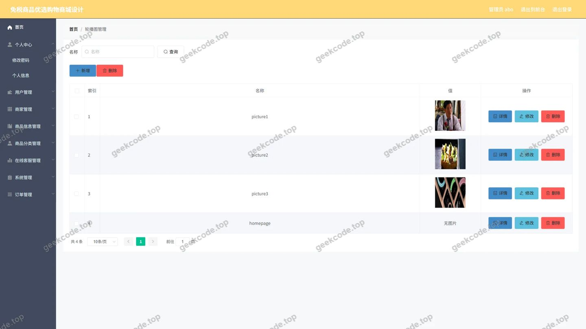</a>

<h4>后台-商品信息评论</h4>

<a href="https://geekcode.top/archives/%E5%9F%BA%E4%BA%8EJava%E7%9A%84%E5%85%8D%E7%A8%8E%E5%95%86%E5%93%81%E4%BC%98%E9%80%89%E8%B4%AD%E7%89%A9%E5%95%86%E5%9F%8E%E8%AE%BE%E8%AE%A1%E4%B8%8E%E5%AE%9E%E7%8E%B0%E4%BB%A3%E7%A0%81?utm_source=github" title="查看完整源码">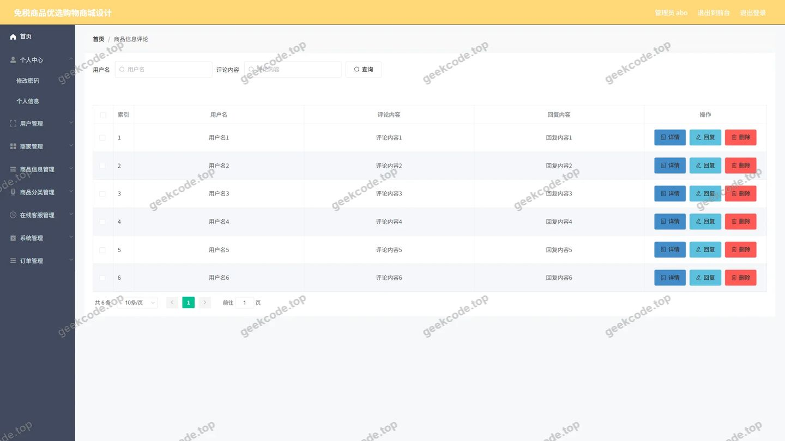</a>

<h4>后台-在线客服评论</h4>

<h4>后台首页</h4>

<a href="https://geekcode.top/archives/%E5%9F%BA%E4%BA%8EJava%E7%9A%84%E5%85%8D%E7%A8%8E%E5%95%86%E5%93%81%E4%BC%98%E9%80%89%E8%B4%AD%E7%89%A9%E5%95%86%E5%9F%8E%E8%AE%BE%E8%AE%A1%E4%B8%8E%E5%AE%9E%E7%8E%B0%E4%BB%A3%E7%A0%81?utm_source=github" title="查看完整源码">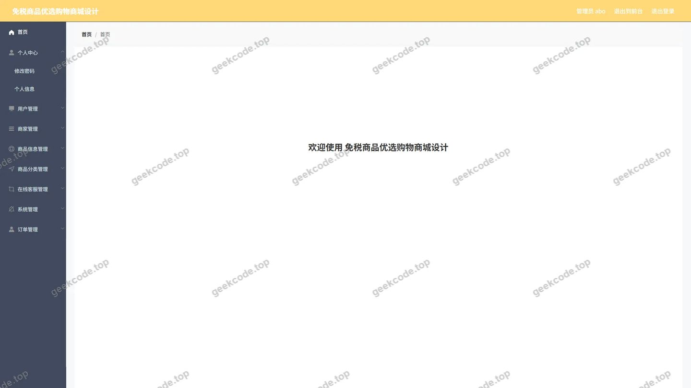</a>

<h4>后台-登录</h4>

<h4>后台-公告信息</h4>

<a href="https://geekcode.top/archives/%E5%9F%BA%E4%BA%8EJava%E7%9A%84%E5%85%8D%E7%A8%8E%E5%95%86%E5%93%81%E4%BC%98%E9%80%89%E8%B4%AD%E7%89%A9%E5%95%86%E5%9F%8E%E8%AE%BE%E8%AE%A1%E4%B8%8E%E5%AE%9E%E7%8E%B0%E4%BB%A3%E7%A0%81?utm_source=github" title="查看完整源码">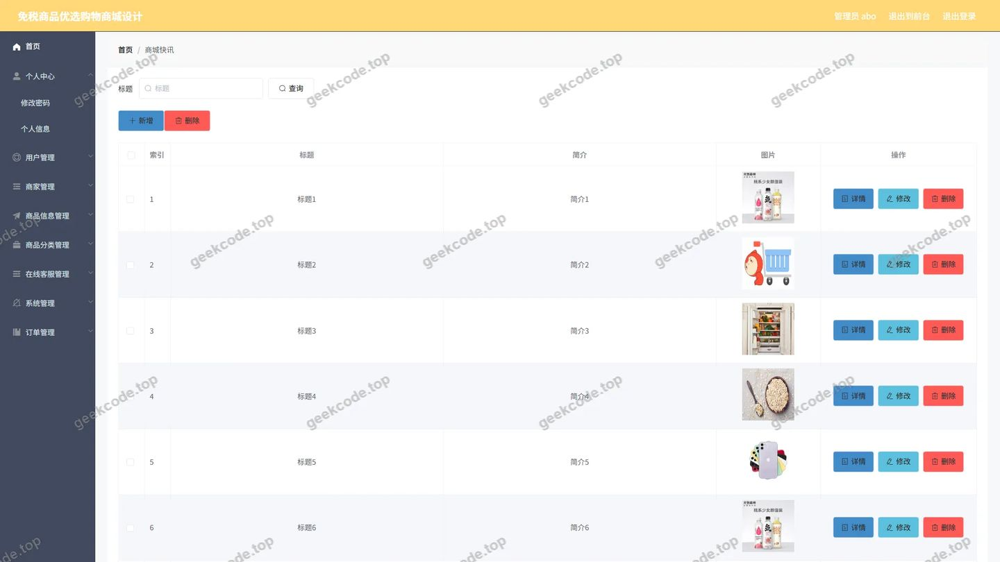</a>

<h4>后台-订单-状态</h4>

<h4>后台-商家</h4>

<a href="https://geekcode.top/archives/%E5%9F%BA%E4%BA%8EJava%E7%9A%84%E5%85%8D%E7%A8%8E%E5%95%86%E5%93%81%E4%BC%98%E9%80%89%E8%B4%AD%E7%89%A9%E5%95%86%E5%9F%8E%E8%AE%BE%E8%AE%A1%E4%B8%8E%E5%AE%9E%E7%8E%B0%E4%BB%A3%E7%A0%81?utm_source=github" title="查看完整源码">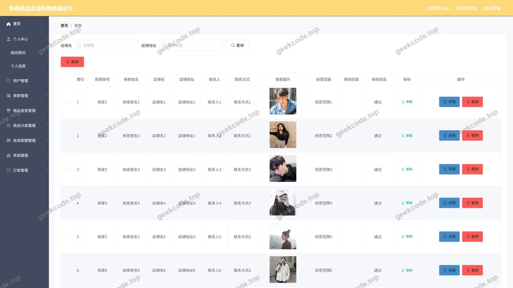</a>

<h4>后台-商品分类</h4>

<a href="https://geekcode.top/archives/%E5%9F%BA%E4%BA%8EJava%E7%9A%84%E5%85%8D%E7%A8%8E%E5%95%86%E5%93%81%E4%BC%98%E9%80%89%E8%B4%AD%E7%89%A9%E5%95%86%E5%9F%8E%E8%AE%BE%E8%AE%A1%E4%B8%8E%E5%AE%9E%E7%8E%B0%E4%BB%A3%E7%A0%81?utm_source=github" title="查看完整源码">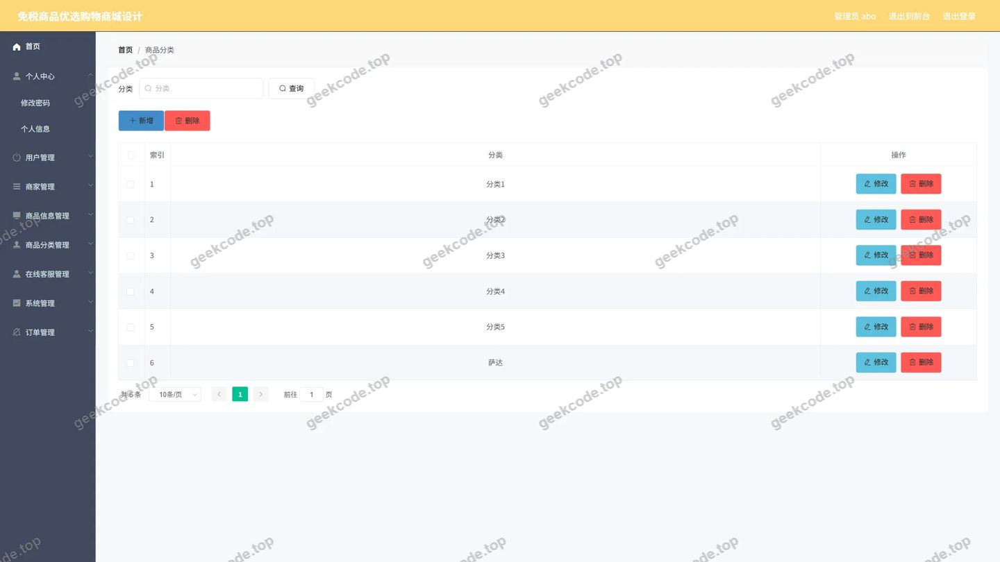</a>

<h4>后台-商品信息</h4>

<a href="https://geekcode.top/archives/%E5%9F%BA%E4%BA%8EJava%E7%9A%84%E5%85%8D%E7%A8%8E%E5%95%86%E5%93%81%E4%BC%98%E9%80%89%E8%B4%AD%E7%89%A9%E5%95%86%E5%9F%8E%E8%AE%BE%E8%AE%A1%E4%B8%8E%E5%AE%9E%E7%8E%B0%E4%BB%A3%E7%A0%81?utm_source=github" title="查看完整源码">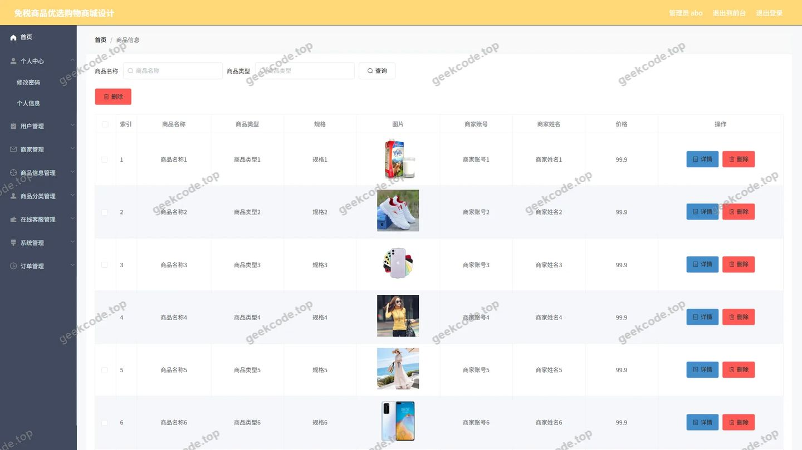</a>

<h4>后台-收藏</h4>

<a href="https://geekcode.top/archives/%E5%9F%BA%E4%BA%8EJava%E7%9A%84%E5%85%8D%E7%A8%8E%E5%95%86%E5%93%81%E4%BC%98%E9%80%89%E8%B4%AD%E7%89%A9%E5%95%86%E5%9F%8E%E8%AE%BE%E8%AE%A1%E4%B8%8E%E5%AE%9E%E7%8E%B0%E4%BB%A3%E7%A0%81?utm_source=github" title="查看完整源码">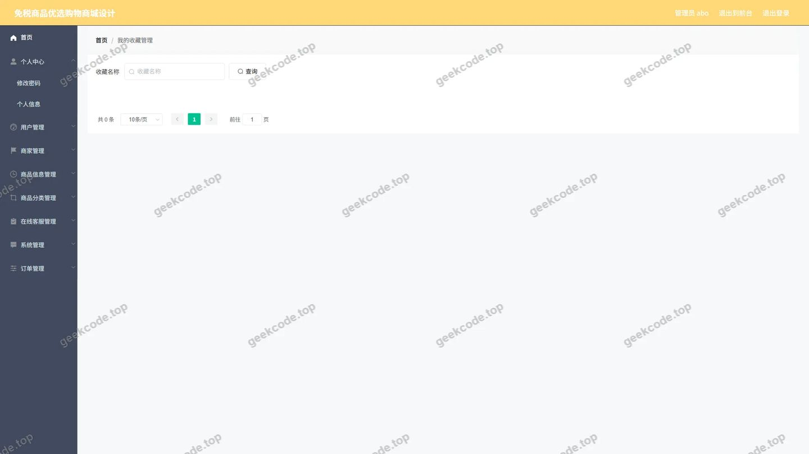</a>

<h4>后台-在线客服</h4>

<a href="https://geekcode.top/archives/%E5%9F%BA%E4%BA%8EJava%E7%9A%84%E5%85%8D%E7%A8%8E%E5%95%86%E5%93%81%E4%BC%98%E9%80%89%E8%B4%AD%E7%89%A9%E5%95%86%E5%9F%8E%E8%AE%BE%E8%AE%A1%E4%B8%8E%E5%AE%9E%E7%8E%B0%E4%BB%A3%E7%A0%81?utm_source=github" title="查看完整源码">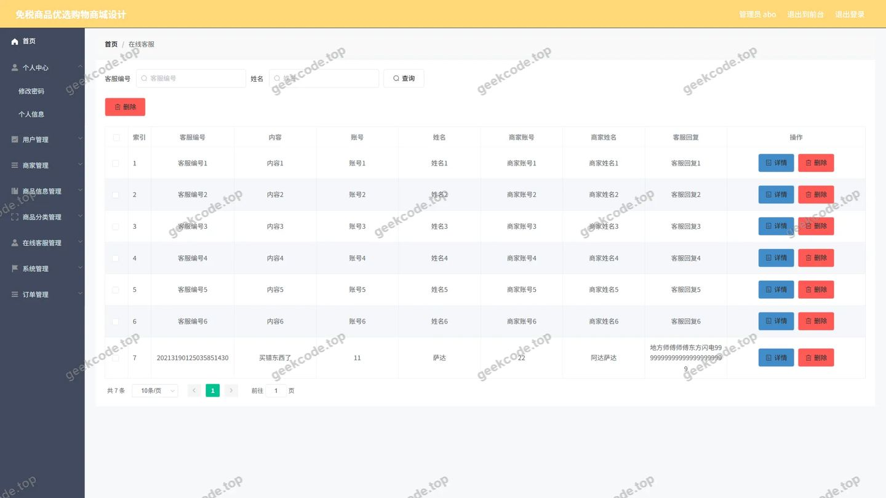</a>

---

## 获取完整源码

| 项目 | 说明 |
| --- | --- |
| 项目名 | 基于Java的免税商品优选购物商城设计与实现代码 |
| 运行截图 | 本文 33 张（站点带水印原图，仓库 `images/` 目录） |
| 完整源码 | [https://geekcode.top/archives/%E5%9F%BA%E4%BA%8EJava%E7%9A%84%E5%85%8D%E7%A8%8E%E5%95%86%E5%93%81%E4%BC%98%E9%80%89%E8%B4%AD%E7%89%A9%E5%95%86%E5%9F%8E%E8%AE%BE%E8%AE%A1%E4%B8%8E%E5%AE%9E%E7%8E%B0%E4%BB%A3%E7%A0%81?utm_source=github](https://geekcode.top/archives/%E5%9F%BA%E4%BA%8EJava%E7%9A%84%E5%85%8D%E7%A8%8E%E5%95%86%E5%93%81%E4%BC%98%E9%80%89%E8%B4%AD%E7%89%A9%E5%95%86%E5%9F%8E%E8%AE%BE%E8%AE%A1%E4%B8%8E%E5%AE%9E%E7%8E%B0%E4%BB%A3%E7%A0%81?utm_source=github) |
| 咨询微信 | **ir9372**（备注：jingpin-yuanma） |
| 更多项目 | [极客代码 geekcode.top](https://geekcode.top/?utm_source=github) |

> 需要源码、部署、改配置、跑不起来等问题，加微信 ir9372 沟通，说明项目名即可。
